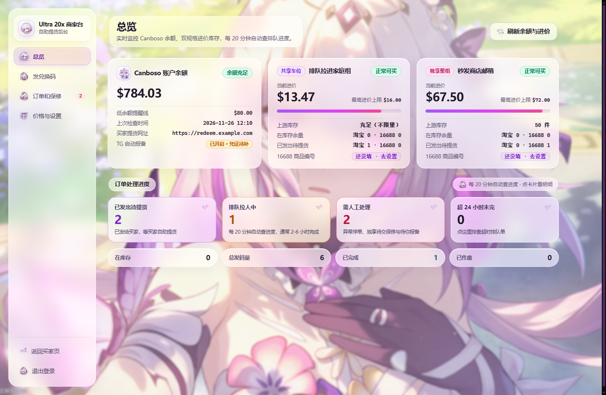
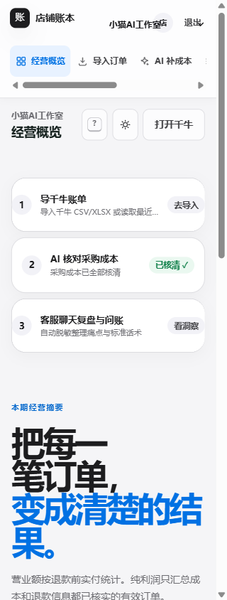
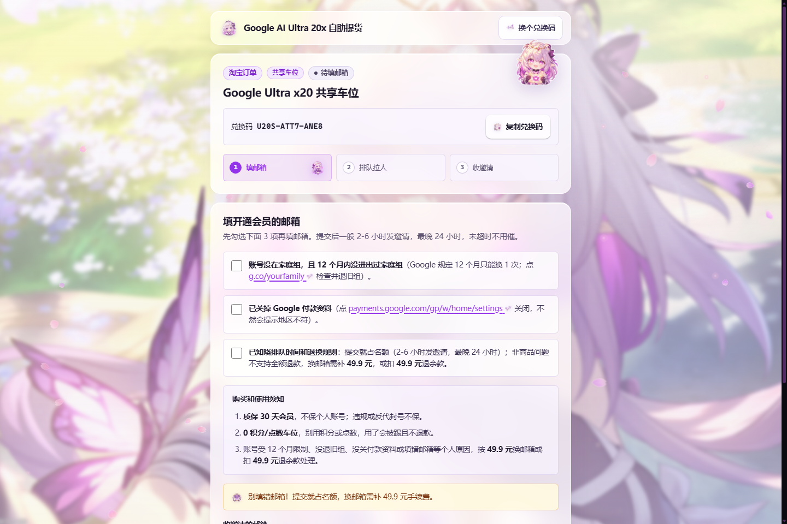
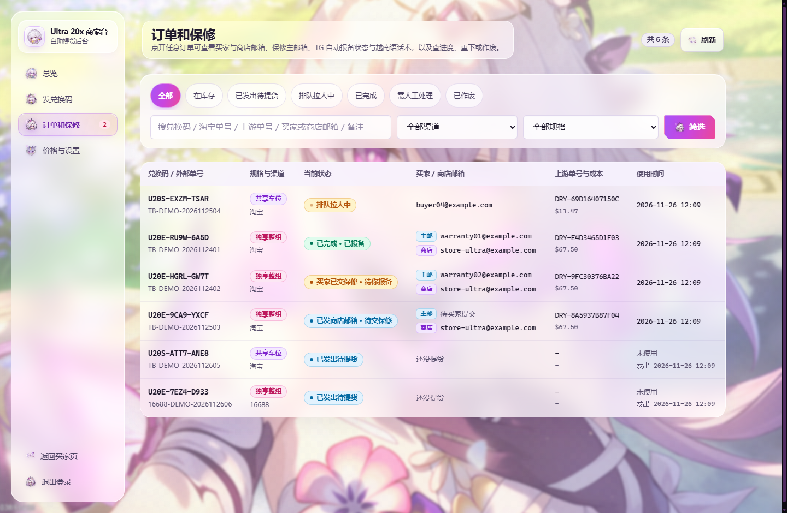
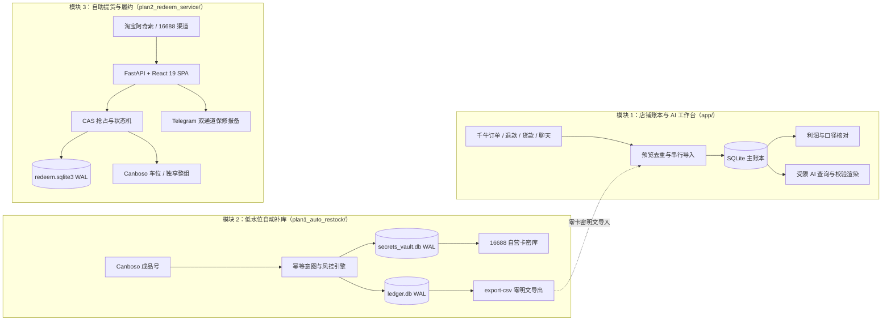

# MultiStore AI Ops

[](https://github.com/wanghaibing07/multistore-ai-ops/actions/workflows/ci.yml)


面向多渠道虚拟商品商家运营的三模块工程仓库，涵盖**账本核算与受限 AI 查账**、**自营卡密低水位自动补库**与**线上自助提货及售后履约服务**。三个模块物理隔离、独立部署，围绕资金防误扣、并发防双花、凭证隔离和可审计核算构建工程护栏。

## 界面预览

以下截图均基于本地 `dry_run` 与合成数据生成，不含任何真实订单、账号或余额信息。

### 店铺账本与 AI 运营工作台（根目录）


### Plan 2 线上自助提货与商家后台（`plan2_redeem_service`）



<details>
<summary>展开更多页面截图（已入库订单与待核对、移动端账本、买家自助提货页、商家订单与保修台）</summary>

| 模块与视图 | 预览 |
| --- | --- |
| 根目录 · 已入库订单与行内成本核对 |  |
| 根目录 · 移动端工作台 |  |
| Plan 2 · 买家端自助提货与前置核对 |  |
| Plan 2 · 商家端订单状态与保修跟踪 |  |

</details>

## 系统拓扑与模块边界

三个模块各自维护独立的 Python 运行环境、认证机制与 SQLite 数据库；运行期唯一的跨模块数据接口，是方案 1 导出的零明文对账 CSV 进入根目录账本，工程侧共用同一套 Git 钩子与 CI 门禁。



| 模块 | 位置与入口 | 核心技术与存储 | 边界与职责 | 模块文档 |
| --- | --- | --- | --- | --- |
| **店铺账本与受限 AI 工作台** | 根目录 `app/main.py`、`app/static/` | Python 3.12 (`uv`)、FastAPI、SQLAlchemy 2.0、Alembic（12 份迁移）、SQLite（`BEGIN IMMEDIATE` 串行写）、原生前端（5 视图）、Docker + Caddy | 汇总千牛订单、退款、货款账单、卡网采购与聊天记录；执行利润/口径/退款人工核对；提供防幻觉的受限 AI 问账 | [架构与数据流](docs/architecture.md)<br>[维护手册](docs/maintenance.md) |
| **方案 1：16688 自动补库守护进程** | `plan1_auto_restock/`（CLI `plan1-restock`） | Python 3.11+、`httpx`、PyYAML、双 SQLite WAL（`ledger.db` + `secrets_vault.db`） | 仅承接 Canboso `account` 成品号补库到 16688 自营卡密；硬拦截非 `account` 商品；支持保险库断电恢复与对账 CSV 导出 | [方案 1 文档](plan1_auto_restock/README.md) |
| **方案 2：自助提货与售后履约服务** | `plan2_redeem_service/`（`backend/` + `frontend/`） | Python 3.12、FastAPI、Uvicorn、SQLite WAL、Telethon / Playwright；React 19 + TypeScript 5.8 + Vite 6.3（同源托管 `frontend/dist/`） | 承接共享车位与独享整组兑换码履约；接入淘宝阿奇索 Webhook/退款联动与 16688 核销补货；支持独享免截图保修与 Telegram 自动报备；云端 `systemd + Caddy` 部署 | [方案 2 文档](plan2_redeem_service/README.md)<br>[接口契约](plan2_redeem_service/API_CONTRACT.md) |

## 核心工程问题与实现对照

| 工程问题 | 设计与实现机制 | 核心代码 | 验证依据 |
| --- | --- | --- | --- |
| **AI 查账幻觉与隐私泄露** | 先用 `canonical_intent()` 固定业务意图，不向模型转发原始提问；模型仅能调用 3 个无参白名单工具（`TOOLS`）并接收匿名化统计（`safe_data()`）；最终数字由服务端根据 `calculate()` 渲染（`verified_answer()`），偏差写入 `AgentRun` 的 `model_numeric_mismatch` | [`app/agent.py`](app/agent.py)<br>[`scripts/evaluate_agent.py`](scripts/evaluate_agent.py) | [`tests/test_api_agent.py`](tests/test_api_agent.py) 与 30 场景离线评测集 |
| **多源账本重复导入、并发写覆盖与利润口径失真** | 导入预览按 `PARSER_VERSION="3"` 去重并生成 `changes_token` 乐观锁；写路径用 `serialize_sqlite_writes()`（`BEGIN IMMEDIATE`）串行化；未知成本不按零计入利润，订单字段变更自动使旧人工核对失效；支持按租户边界批量删单及级联清理 | [`app/importer.py`](app/importer.py)<br>[`app/accounting.py`](app/accounting.py)<br>[`app/card_reconciliation.py`](app/card_reconciliation.py) | 根目录 `96 passed`（含去重、口径、核对失效与租户隔离测试） |
| **自动补库误扣资金、超时双花与卡密明文泄露** | 默认 `dry_run: true`，实盘需同时传入 `--live --i-confirm-real-spend` 双锁；`DualDatabaseStore` 将普通账本 `ledger.db` 与明文卡密 `secrets_vault.db` 物理分离；先落 `PENDING` 意图和 `Idempotency-Key`，下单后先写保险库再传 16688，异常通过 `recover` 补传不重买；内置涨价超 35% 自动下架与日预算/余额熔断 | [`plan1_auto_restock/plan1_auto_restock/engine.py`](plan1_auto_restock/plan1_auto_restock/engine.py)<br>[`plan1_auto_restock/plan1_auto_restock/storage.py`](plan1_auto_restock/plan1_auto_restock/storage.py)<br>[`plan1_auto_restock/plan1_auto_restock/pricing.py`](plan1_auto_restock/plan1_auto_restock/pricing.py) | 方案 1 `18 passed`（含超时重放、双库隔离、涨价熔断与 CSV 零明文导出） |
| **兑换码并发抢单双花与异常状态不可控** | `claim_for_purchase()` 在 `BEGIN IMMEDIATE` 事务内执行原子 CAS 抢占，阻断同一兑换码并发下单；`transition()` 严格约束状态流转，上游价格超上限、余额不足或 24h 超时自动转入 `needs_manual_review` 并向买家屏蔽内部错误详情 | [`plan2_redeem_service/backend/db.py`](plan2_redeem_service/backend/db.py)<br>[`plan2_redeem_service/backend/service.py`](plan2_redeem_service/backend/service.py) | 方案 2 后端 `98 passed`（含并发防双花、价格熔断与重试测试） |
| **淘宝阿奇索回调重放、重复发码与退款未作废** | 校验 MD5 签名（`hmac.compare_digest`）与 600 秒重放窗口；`agiso_deliveries` 以 `delivery_key` / `code` 唯一索引兜底去重；退款自动作废未核销兑换码，退款关闭满足 6 项条件自动恢复；定时巡检阿奇索与 16688 低水位自动补码 | [`plan2_redeem_service/backend/agiso.py`](plan2_redeem_service/backend/agiso.py)<br>[`plan2_redeem_service/backend/service.py`](plan2_redeem_service/backend/service.py) | 方案 2 阿奇索 Webhook、退款联动与低水位补货单测 |
| **独享整组售后报备人工耗时与通道故障** | 买家免截图提交保修组长邮箱后，支持 `telethon`（MTProto）与 `PlaywrightTelegramWebForwarder`（Web K 持久化会话 + 纯数字 `peerId` 校验 + 文件锁）双通道自动向管理员报备；失败降级为邮件告警并在商家后台支持一键重试 | [`plan2_redeem_service/backend/telegram_forwarder.py`](plan2_redeem_service/backend/telegram_forwarder.py)<br>[`plan2_redeem_service/backend/service.py`](plan2_redeem_service/backend/service.py) | 方案 2 Telegram 双通道转发、脱敏报错与失败兜底单测 |

## 快速开始

环境前置：Windows 推荐 PowerShell 7、Python 3.12、`uv` 与 Node.js 20（修改方案 2 前端时需要）。

### 1. 启用仓库 Git 钩子

克隆后先启用内建防泄密、空白检查与提交规范钩子：

```powershell
git config core.hooksPath .githooks
```

### 2. 启动根目录店铺账本（本地试用）

```powershell
uv sync --locked
uv run alembic upgrade head
uv run python -m app.cli init --username owner --store '示例店铺' --generate-password
uv run uvicorn app.main:app --host 127.0.0.1 --port 8018 --no-access-log
```

访问 `http://127.0.0.1:8018`。初始密码会写入已被 `.gitignore` 排除的 `private/initial-login.txt`。如需启用 AI 问账，复制 `.env.example` 为 `.env` 并填写兼容 Chat Completions 工具调用的模型配置；未配置模型时账本与核算功能不受影响。

使用 Docker Compose 启动根目录服务：

```powershell
Copy-Item .env.example .env
docker compose run --rm app python -m app.cli init --username owner --store '示例店铺' --generate-password
docker compose up -d --build
```

公网部署时请设置 `MULTISTORE_PUBLIC_MODE=1` 关闭快捷登录入口。

### 3. 启动方案 1 与方案 2

- **方案 1（默认演练模式）**：见 [plan1_auto_restock/README.md](plan1_auto_restock/README.md)，按模板创建 `.env` 与 `config.local.yaml` 后运行 `check` / `sync-once --dry-run`。
- **方案 2（本地 `dry_run` 与云端运维）**：见 [plan2_redeem_service/README.md](plan2_redeem_service/README.md)。本地调试默认使用 `PLAN2_EXECUTION_MODE=dry_run`；云端生产主机（`plan2-prod`）的状态检查、日志查看与发布统一通过 [`scripts/plan2-cloud.ps1`](scripts/plan2-cloud.ps1) 执行。

## 自动化验证与 CI 门禁

每次推送和 PR 会触发 [`.github/workflows/ci.yml`](.github/workflows/ci.yml) 中的 5 个并行 Job：

| CI Job | 覆盖范围 | 本地复现命令 |
| --- | --- | --- |
| `Root Ledger & AI Ops` | 根目录 96 项 pytest + Alembic 迁移一致性 | `uv run pytest -q && uv run alembic upgrade head && uv run alembic check` |
| `Plan 1 Auto-Restock` | 方案 1 共 18 项 pytest（双库、幂等、熔断、导出） | `uv run --no-project --with-editable ./plan1_auto_restock --with pytest pytest plan1_auto_restock/tests -q` |
| `Plan 2 Redeem Backend` | 方案 2 后端 98 项 pytest（CAS、阿奇索、TG 报备） | `.\plan2_redeem_service\.venv\Scripts\python.exe -X utf8 -m pytest plan2_redeem_service\tests -q` |
| `Plan 2 Redeem Frontend` | React + TS 类型检查、构建与 `frontend/dist/` 同步校验 | `npm --prefix plan2_redeem_service/frontend run typecheck && npm --prefix plan2_redeem_service/frontend run build` |
| `Repo Hygiene & Secret Guard` | `.githooks` 语法/行为验证与敏感路径追踪拦截 | `sh -n .githooks/pre-commit .githooks/commit-msg` |

根目录另提供 30 场景离线 AI 评测脚本（结果写入被忽略目录）：

```powershell
uv run python -X utf8 scripts/evaluate_agent.py --output .\private\agent-evaluation.json
```

## 文档导航

| 文档 | 类型 | 适用场景 |
| --- | --- | --- |
| [`docs/architecture.md`](docs/architecture.md) | 架构说明 | 了解三模块物理隔离、数据表分层、状态机与安全/AI 边界 |
| [`docs/maintenance.md`](docs/maintenance.md) | 运维与开发指南 | 查目录地图、Alembic 迁移、核算规则、云端运维与提交流程 |
| [`plan1_auto_restock/README.md`](plan1_auto_restock/README.md) | 模块操作与参考 | 方案 1 配置、全部 CLI 子命令、双库恢复与 16688 接口实测说明 |
| [`plan2_redeem_service/README.md`](plan2_redeem_service/README.md) | 模块操作与参考 | 方案 2 本地/云端启动、阿奇索/16688/Telegram 环境变量与前端构建门禁 |
| [`plan2_redeem_service/API_CONTRACT.md`](plan2_redeem_service/API_CONTRACT.md) | 接口契约 | 方案 2 前后端数据结构、状态枚举、通知策略与 API 定义 |

> [!NOTE]
> **数据安全与运行边界**：真实密钥、`.env`、`*.local.yaml`、SQLite 数据库（`*.db`/`*.sqlite*`）、运行期 `data/` 与 `private/` 目录均由 `.gitignore`、`.githooks/pre-commit` 与 CI 共同拦截，仓库仅保留脱敏模板与合成测试数据。三个模块当前均面向单机或单台云主机 SQLite 场景；根目录账本以人工导出和人工确认匹配为主，不执行绕过平台风控的无人值守抓取；方案 1 仅处理 `productType=account` 成品号。
