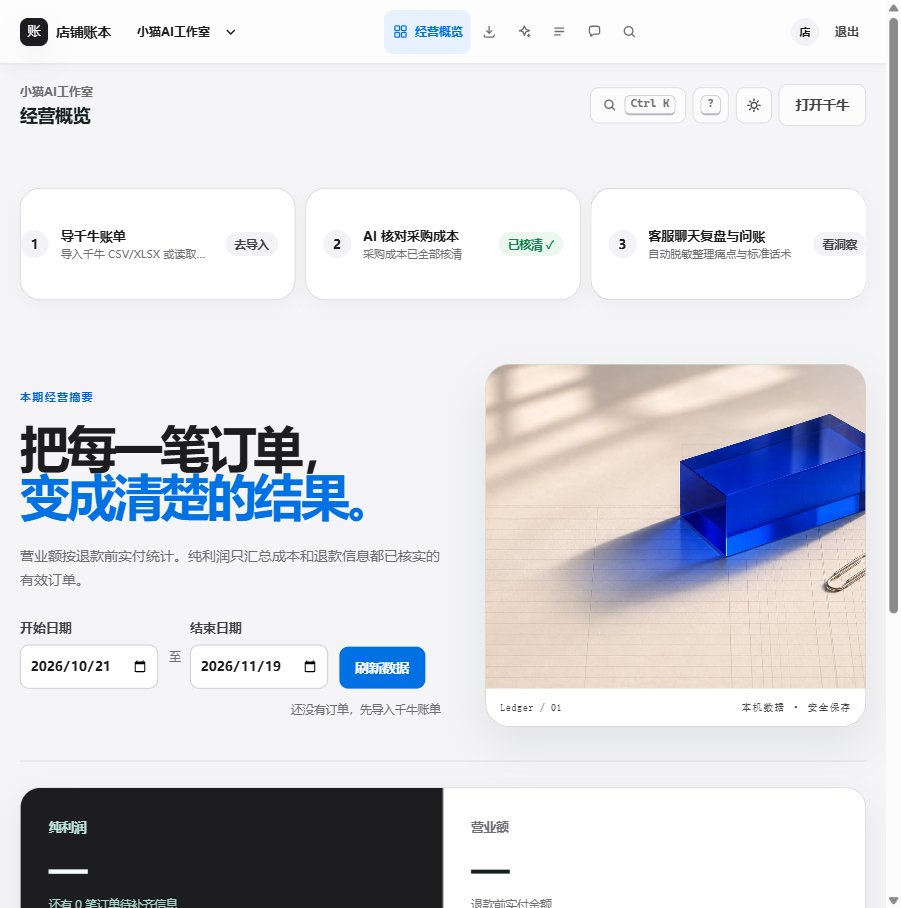
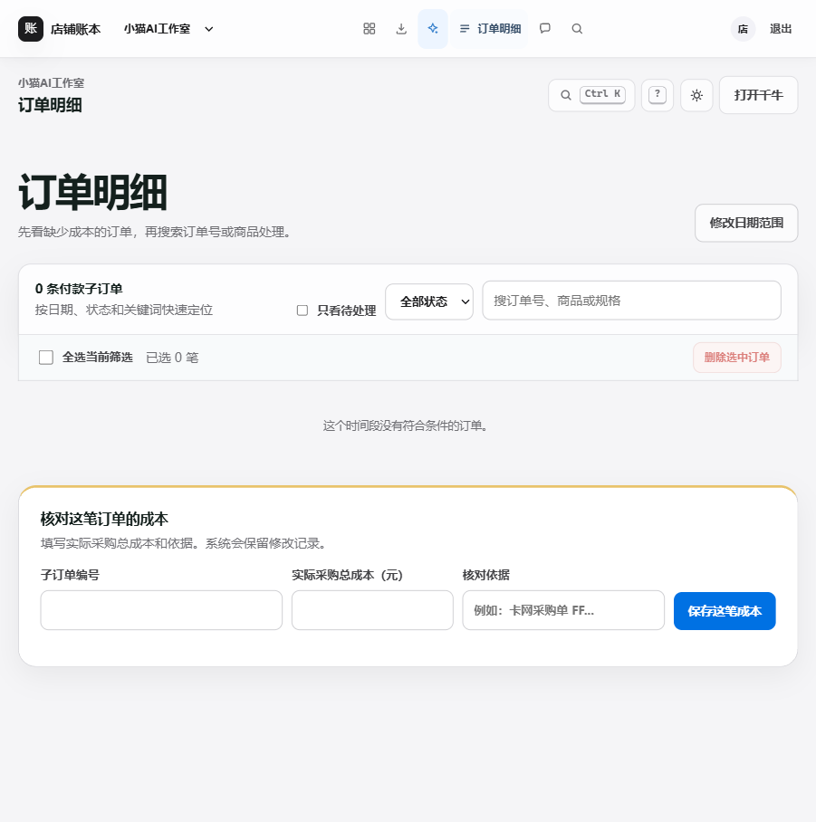

# 店铺账本 | MultiStore AI Ops

一个面向真实商家运营流程的 AI 辅助核对工作台。

它把千牛订单、退款、货款账单、卡网采购单和商品成本放在同一条核对链路里，帮助店主回答几个每天都会遇到的问题。

- 这笔订单到底有没有完整核对
- 采购成本应该归到哪一笔销售订单
- 哪些退款会影响当前利润
- AI 能不能帮我查数据，同时保证答案里的数字有来源

## 项目定位

这是一个 AI Agent 与传统业务系统协作的示例项目。

- 业务数据由服务端账本计算，订单、成本、退款和利润不会交给模型自由生成
- AI 负责把自然语言问题转换成受限查询意图，并在允许的工具范围内读取脱敏结果
- 人工负责确认采购匹配、退款历史和金额口径
- 每次核对都会留下时间、依据和关联订单，方便回看与追责

这个边界让 AI 有实际工作价值，也让关键经营数字可以被测试和复核。

## 它解决的业务问题

小型店铺的经营数据通常分散在不同导出文件和网页里。订单在千牛，采购在卡网，退款在售后记录，实际打款还会出现在货款账单。单纯做一个订单列表并不能回答利润问题，单纯接一个大模型也无法替代金额口径和人工确认。

这个项目把流程收敛为一条可操作的闭环。

~~~mermaid
flowchart LR
    A[导入订单与退款] --> B[保存原始字段与批次]
    C[导入卡网采购单] --> D[按订单号去重]
    B --> E[服务端账本计算]
    D --> F[商品与时间候选匹配]
    F --> G{人工确认}
    G --> E
    E --> H[利润与待核对清单]
    E --> I[AI 受限查询]
    I --> H
~~~

## 核心能力

### 订单与采购核对

- 支持千牛订单、退款、货款账单和成本表导入
- 支持 16688、链动小铺等卡网订单的 JSON、CSV、XLSX、TSV 和复制文本
- 已导入采购单按真实订单号去重，重复导入不会重复入账
- 采购记录按成品号、激活、家庭组分类，可按订单号、商品名、时间搜索和筛选
- 支持批量删除错误导入的订单，并同步清理订单范围内的匹配、退款和成本核对记录

### 可信核算

- 利润按子订单计算，未知成本不会按零处理
- 退款快照、人工核对结果和货款流水分开保存
- 成本支持按 SKU 版本和逐单采购总成本记录
- 导入前展示时间范围、重复记录和字段变化
- 并发导入时使用 SQLite 写锁，避免旧数据覆盖新记录

### AI 辅助运营

- 自然语言查询利润、订单、退款和待核对事项
- 只向模型发送固定经营意图和脱敏统计，不发送原始提问中的个人信息
- 模型只能选择白名单工具，工具结果回到服务端后再生成最终回答
- 模型不可用时，导入、核对和利润计算仍可独立使用

### 面向日常工作的界面

- 工作台首页聚合利润、待核对数量、采购匹配和最近批次
- 订单页支持搜索、状态筛选、类目筛选和批量删除
- 采购核对页把候选匹配、评分、人工确认和核对历史放在同一视图
- 使用低干扰的浅色账本界面和移动端布局，适合长时间核对

## AI 参与边界

| 环节 | AI 可以做什么 | 服务端和人工负责什么 |
| --- | --- | --- |
| 问题理解 | 识别利润、订单、退款等固定意图 | 校验时间范围、店铺权限和查询条件 |
| 数据读取 | 选择白名单查询工具 | 从 SQLite 读取真实账本并计算结果 |
| 采购匹配 | 根据商品标题、规格、数量、金额和时间提出候选 | 人工确认订单、成本和依据 |
| 结果表达 | 将已验证的结果整理成自然语言 | 最终数字和状态来自计算结果 |
| 异常处理 | 给出缺少字段或无法匹配的提示 | 进入待核对流程，不自动补零或猜测 |

## 技术结构

~~~text
FastAPI
├── app/main.py                 HTTP API、鉴权、导入与删除入口
├── app/models.py               SQLAlchemy 数据模型
├── app/importer.py             CSV/XLSX/复制文本清洗与批次导入
├── app/accounting.py           订单、成本、退款和利润计算
├── app/card_reconciliation.py  采购去重、分类、候选匹配与确认
├── app/agent.py                受限 AI 查询与验证后回答
├── app/card_query_ai.py        卡网查询辅助与人工接管流程
├── app/qianniu_chats.py        千牛聊天导入与知识库
└── app/static/                 原生 HTML、CSS 和 JavaScript 工作台

SQLite + Alembic
Pytest
Docker Compose + Caddy
~~~

项目选择 FastAPI、SQLAlchemy、SQLite 和原生前端，是为了让业务规则、数据来源和浏览器行为都容易检查。数据库模型和计算逻辑可以独立测试，前端不依赖构建服务，单机试用和容器部署的路径都保持简单。

## 公开仓库中的数据边界

- 真实数据库、导出文件、截图证据、账号初始化文件和环境变量均被 Git 忽略
- .env.example 只保留配置名，不包含模型密钥
- 示例测试数据使用合成订单和占位联系方式
- 卡网登录、验证码、滑块和外部账号授权由店主本人完成
- 公开代码没有承诺无人值守抓取外部网站，外部页面变化时仍需要人工确认

## 本机运行

环境要求是 PowerShell 7、Python 3.12 和 uv。

~~~powershell
uv sync --locked
uv run alembic upgrade head
uv run python -m app.cli init --username owner --store '我的店铺' --generate-password
uv run uvicorn app.main:app --host 127.0.0.1 --port 8018 --no-access-log
~~~

打开 http://127.0.0.1:8018。初始密码会写入被 Git 忽略的 private/initial-login.txt。

模型配置写在根目录 .env，可参考 .env.example。模型地址需要兼容 Chat Completions 的工具调用格式。缺少模型配置时，账本核算仍可使用。

## Docker 试用

~~~powershell
Copy-Item .env.example .env
docker compose run --rm app python -m app.cli init --username owner --store '我的店铺' --generate-password
docker compose up -d --build
~~~

正式暴露到公网前，需要在服务器上配置 HTTPS、强密码、备份恢复和账号授权。默认的本机模式会保留免密进入能力，远程部署时应设置 MULTISTORE_PUBLIC_MODE=1。

## 验证

~~~powershell
uv run pytest -q
uv run alembic check
uv run python -X utf8 scripts/evaluate_agent.py --output PATH_TO_NEW_SYNTHETIC_RESULT.json
~~~

当前本地验证包括完整测试集、采购分类和去重、订单批量删除、AI 工具权限、模型虚构数字拦截、脱敏、备份恢复以及桌面和移动端页面检查。最新一次完整测试为 77 passed。

## 面试讲解路径

可以用下面的顺序介绍这个项目。

1. 从多来源订单和采购数据难以对账的具体问题开始
2. 展示导入、去重、匹配、人工确认和利润计算的完整链路
3. 说明为什么 AI 只做意图识别和候选建议，最终数字由服务端计算
4. 展示测试如何验证租户隔离、敏感字段脱敏、白名单工具和批量删除
5. 说明当前边界，以及下一步可以接入的真实数据源和异步任务能力

这个项目体现的能力包括业务建模、数据清洗、可靠性设计、AI Agent 约束、全栈交互和可验证交付。

## 当前限制

- 当前公开版本以本机导入为主，外部平台仍依赖人工登录和导出
- 采购匹配评分用于排序和辅助核对，不代表自动确认
- AI 查询依赖兼容的模型接口，模型服务异常时不会影响账本计算
- SQLite 更适合单机或小规模团队试用，规模扩大后需要评估 PostgreSQL 和异步导入

## 相关文档

- [架构与数据流](docs/architecture.md)
- [环境变量模板](.env.example)
- [数据库迁移](migrations/)
- [测试用例](tests/)

## 项目状态

当前版本适合用于本机试用、面试演示和进一步扩展。发布前请替换自己的店铺名称、创建初始账号，并使用合成数据完成演示。

\n