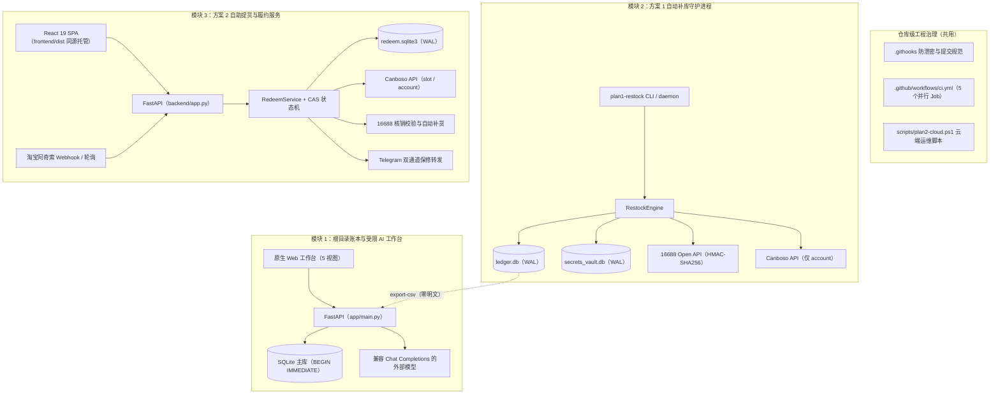
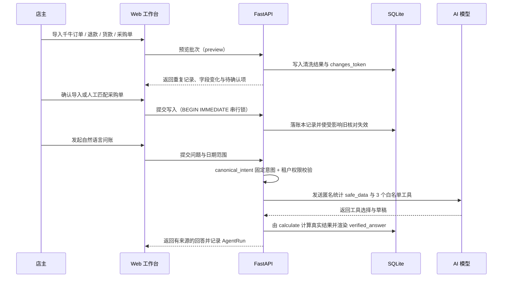
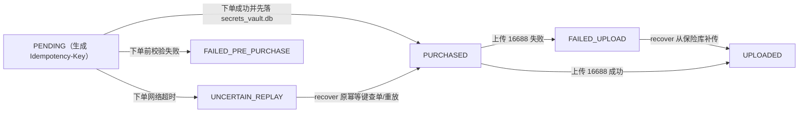
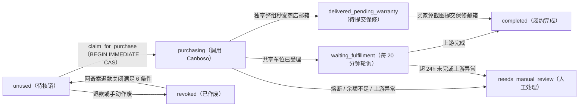

# 架构与数据流

> 返回 [仓库首页](../README.md) · 日常操作与排障见 [维护手册](maintenance.md)

## 总体设计原则

MultiStore AI Ops 由三个物理隔离的模块组成，分别解决账本核算、成品号低水位自动补库与高客单自助提货履约问题。仓库没有把三类不同风险等级的业务合并进单一进程和单一数据库，原因有两点：

1. **故障域与资金权限隔离**：根目录账本只做统计核对，不持有上游采购密钥；方案 1 与方案 2 持有上游扣款和发卡凭据，且按商品类型拆分为“成品号直接入卡密库”和“兑换码按需采购”两条独立链路。
2. **部署形态差异**：根目录偏本机或私有容器内网使用；方案 1 是无 UI 的 CLI / 常驻守护进程；方案 2 是长期运行在云端主机（`systemd + Caddy`）的公网全栈服务。

三个模块拥有各自独立的 Python 虚拟环境、依赖清单、鉴权体系和 SQLite 文件。运行期唯一的跨模块数据交互，是方案 1 通过 `export-csv` 导出零卡密明文的采购对账文件，再由店主导入根目录账本。

## 模块 1：店铺账本与受限 AI 工作台（`app/`）

### 请求与核算路径

### 数据分层（`app/models.py`，共 18 张表）

1. **租户与配置层**：`Store`、`User`、`Membership`、`LoginSession`、`StoreSetting`，用于多店铺租户隔离、会话状态与店铺级配置。
2. **来源层**：`ImportBatch`、`ImportRow`，记录导入批次、文件摘要、清洗后行数据与 `PARSER_VERSION="3"`；原始上传文件不作为长期应用数据保存。
3. **业务核算层**：`OrderItem`（可核对订单子项）、`Refund`（退款流水）、`Cashflow`（货款与售后资金流水）、`CostVersion`（按 SKU 与生效日期管理的成本版本）、`CardPurchase`（外部采购单与去重指纹）。
4. **证据与知识层**：`CardMatch`（采购候选与人工确认）、`Adjustment`（逐单成本与冲正）、`RefundReview`（退款完整性核对）、`PaymentBasisReview`（实付/净额口径核对）、`AgentRun`（受限 AI 查询日志与数字偏差记录）、`ChatSession` 与 `ChatKnowledgeItem`（千牛聊天导入与脱敏知识条目）。

### 受限 AI 边界（`app/agent.py`）

- **不透传原始提问**：`canonical_intent()` 先把用户输入规整为固定经营意图；服务端自行决定店铺 ID、时间范围与 SKU 过滤条件。
- **零参白名单工具**：`TOOLS` 仅开放 3 个无参只读工具，禁止模型拼接 SQL 或任意参数。
- **匿名化输入**：`safe_data()` 将真实商品标题映射为匿名代号，去除订单号与买家信息后再发送给模型。
- **服务端确定性渲染**：最终展示的数字与状态统一由 `verified_answer()` 根据 `calculate()` 结果生成；若模型草稿中的数字与账本计算值不一致，结果会被服务端覆盖并在 `AgentRun` 中记录 `model_numeric_mismatch`。
- **模型外链约束与降级**：`call_model()` 仅允许 HTTPS 或本机回环地址；模型未配置或超时时，导入、核对和利润核算仍完全可用。

### 并发、一致性与安全边界

- **SQLite 并发策略**：`app/db.py` 启用 `PRAGMA foreign_keys=ON` 与 `busy_timeout=10000`（未开启 WAL）；导入、删除等写路径通过 `app/importer.py` 中的 `serialize_sqlite_writes()` 执行 `BEGIN IMMEDIATE` 串行化，配合预览阶段生成的 `changes_token` 防止并发覆盖。
- **核对失效与级联清理**：订单字段变更会自动使旧人工核对失效；批量删除订单时同步清理订单范围内的退款、现金流、采购匹配、核对与调整记录。
- **认证与防护**：`app/auth.py` 使用 Argon2（`pwdlib`）哈希密码并做恒定时间哑哈希防枚举，登录接口限流 10 次 / 60 秒；会话 Cookie 存 SHA-256 摘要且标记 `HttpOnly` + `SameSite=Strict`；写接口使用 `hmac.compare_digest` 校验 CSRF；租户接口强制经过 `require_store()`；远程公网部署通过 `MULTISTORE_PUBLIC_MODE=1` 关闭快捷登录。
- **容器加固**：根 `docker-compose.yml` 与 `Dockerfile` 以非 root 用户（`merchant`，UID 10001）和只读根文件系统运行，由 Caddy 负责反向代理；热备份由 `app/backup.py` 提供。

## 模块 2：方案 1 自动补库守护进程（`plan1_auto_restock/`）

### 双库 WAL 物理隔离（`storage.py`）

`DualDatabaseStore` 同时管理两个开启 `PRAGMA journal_mode=WAL` 的 SQLite 数据库：

- **`ledger.db`（普通对账库，6 张表）**：`restock_intents`、`sku_state`、`orders_16688`、`complaints_16688`、`events`、`alert_throttle`。写入订单元数据前经 `sanitize_order_meta()` 剥离明文凭据。
- **`secrets_vault.db`（卡密保险库，1 张表）**：仅存 `vault_items`，保存上游购得的原始卡密及上传状态，与普通对账库和 CSV 导出物理隔离。

### 幂等意图状态机与零丢卡恢复（`engine.py`）

每次补库都先持久化意图记录与 `Idempotency-Key`，采购成功后第一时间写入 `secrets_vault.db`，最后才调用 16688 接口上传库存。任何中断都可通过 `plan1-restock recover` 从保险库补传或按原幂等键确认上游结果，避免丢卡或重复扣款。

### 风控与防误扣护栏

- **实盘双锁**：配置默认 `dry_run: true`，实盘下单必须在命令行同时提供 `--live` 和 `--i-confirm-real-spend`。
- **商品类型硬拦截**：仅允许 `productType=account` 成品号；`slot` 和 `upgrade_account` 直接阻断。
- **价格与预算熔断**：`pricing.py` 中的 `evaluate_pricing()` 默认监控上游涨价幅度（超过 35% 自动熔断并下架 16688 对应商品），配合单次件数上限、单日美元预算、钱包最低余额、冷却间隔、断货归零自动下架与 Canboso 401/403 鉴权熔断。
- **签名与告警**：16688 请求使用 HMAC-SHA256 签名（`signing_16688.py`）；告警支持 Webhook 与 SMTP（SSL 465）双通道，按事件类型 30 分钟节流冷却。
- **零明文跨模块导出**：`exporter.py` 的 `export_multistore_csv()` 仅从 `ledger.db` 生成对账 CSV，供根目录账本导入核对。

## 模块 3：方案 2 自助提货与履约服务（`plan2_redeem_service/`）

### 部署与存储拓扑

- **同源全栈**：后端为 FastAPI + Uvicorn 单进程（`--workers 1`），前端为 React 19 + TypeScript 5.8 + Vite 6.3 SPA，构建产物 `frontend/dist/` 随源码一并提交并由后端同源托管。
- **SQLite WAL 数据模型（`backend/db.py`，共 8 张表）**：`sku_settings`、`codes`、`audit_events`、`batches`、`notification_keys`、`agiso_sku_mappings`、`agiso_deliveries`、`agiso_events`。
- **生产托管**：云端固定运行于 `plan2-prod` 主机 `/opt/plan2_redeem_service`，由 `plan2-redeem.service`（监听 `127.0.0.1:8000`）与 `caddy.service` 反向代理提供 HTTPS，日常运维统一通过根目录 `scripts/plan2-cloud.ps1` 执行。

### 兑换码原子抢占与状态流转（`backend/db.py`、`backend/service.py`）

- `STATUSES` 枚举中保留了 `validating` 占位态，运行期核销抢占由 `claim_for_purchase()` 在 `BEGIN IMMEDIATE` 事务中直接完成 `unused -> purchasing` 的原子 CAS，避免同一兑换码在并发请求下向 Canboso 重复扣款。
- 上游预检会校验 `max_cost_usd`、钱包余额与库存；任何风控阻断或上游故障统一进入 `needs_manual_review`，对买家隐藏内部异常细节并触发邮件告警。

### 淘宝阿奇索与 16688 渠道联动（`backend/agiso.py`、`backend/service.py`）

- **防篡改与防重放**：Webhook 回调使用 MD5 签名与 `hmac.compare_digest` 校验，默认强制 600 秒时间戳重放窗口。
- **原子发码去重**：`agiso_deliveries` 通过 `delivery_key` 与 `code` 唯一约束保证同一淘宝子订单只发放一次兑换码；SKU 规则支持数据库配置与环境变量回退，按优先级匹配。
- **退款闭环与自动补货**：收到退款回调时自动作废未核销兑换码；当退款关闭且同时满足开关启用、非退款成功、`last_error_code == "REFUNDED"`、未提交核销、无上游订单且最近作废审计原因匹配退款作废这 6 项条件时自动恢复可用。后台定时任务同时支持阿奇索卡券库（`agiso_restocker`）与 16688 卡密库存（`channel16688_restocker`）低水位自动补码。

### 独享整组双通道 Telegram 保修报备（`backend/telegram_forwarder.py`）

独享整组（`ultra_exclusive_admin`）支持免截图提交家庭组主邮箱后，自动向 Canboso 管理员发送保修报备消息：

- **通道一（`telethon`）**：基于 MTProto `StringSession` 直连发送，支持纯数字 `peerId` 或 `@username`。
- **通道二（`PlaywrightTelegramWebForwarder`）**：基于持久化 Chromium Profile 操作 Telegram Web K，强制校验纯数字 `peerId` 防误发，配合 Profile 文件锁（`_profile_file_lock`）与 `systemd ProtectHome=true` 路径回退策略避免会话冲突。
- **失败降级**：自动报备未启用或执行失败时，错误经 `sanitize_tg_error()` 脱敏后发送兜底邮件告警，商家可在后台 `/warranty-forward` 手动重试。

## 架构权衡与演进方向

1. **SQLite 并发边界**：当前三个模块分别采用单机 SQLite（根目录串行写、方案 1/2 开启 WAL）以降低部署和维护复杂度；若单模块并发写入或报表分析规模显著增长，可优先将根目录账本迁移至 PostgreSQL，并把导入/AI 评测移入异步队列。
2. **外部平台适配**：根目录千牛数据仍以人工导出和人工确认匹配为边界，避免脆弱页面抓取带来风控与账务误差；后续可将标准化的连接器抽象为带版本契约的导入适配器。
3. **前端测试覆盖**：方案 2 前端当前由 TypeScript 类型检查、生产构建与 `frontend/dist/` 同步门禁把关，后续可补充关键表单和状态渲染的 Vitest 组件测试。
